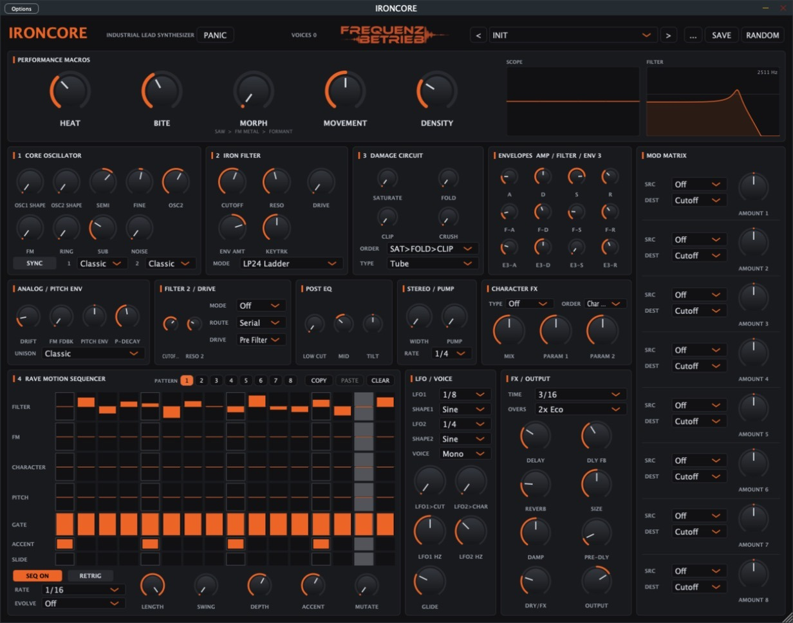

<p align="center">
  <a href="https://www.frequenzbetrieb.de"></a>
</p>

<h1 align="center">IRONCORE</h1>
<p align="center"><b>Industrial Lead Synthesizer</b> &middot; VST3 / AU / Standalone &middot; Windows &amp; macOS<br>
Ein Open-Source-Projekt von <a href="https://www.frequenzbetrieb.de">Frequenzbetrieb n.e.V.</a></p>

<p align="center">
  <a href="../../actions/workflows/build.yml"></a>
  <a href="LICENSE"></a>
</p>



IRONCORE ist ein spezialisierter Software-Synthesizer für **Schranz, Hard Techno, Industrial Techno und aggressive Rave-Leads**. MIDI rein, druckvoller und beweglicher Lead heraus, ohne fünf externe Plugins.

## Funktionen

- **5 Performance-Makros:** HEAT, BITE, MORPH, MOVEMENT, DENSITY
- **Core Oscillator:** zwei Oszillatoren mit eigenem Typ (Classic, 4 Wavetable-Sets, Phase Distortion, Karplus-Strong-Resonator, Noise), Unison bis 7 Stimmen (Supersaw), Hard Sync, Ringmod, FM mit Feedback, Sub, Analog-Drift
- **Character Morphing:** Saw-Lead → metallisches FM → Vokal-Formanten
- **Iron Filter:** nichtlineares 4-Pol-Ladder, LP12, BP Scream, HP und ein zweites Filter (seriell/parallel)
- **Damage Circuit:** 6 Sättigungstypen, Wavefold, Clip, Bitcrush, umschaltbare Reihenfolge; komplett abschaltbar für einen sauberen Signalweg
- **Rave Motion Sequencer:** 16 Steps, 7 Spuren (Filter, FM, Character, Pitch, Gate, Accent, Slide), Swing, Polyrhythmen über Spurlängen, Step-Mutation, Pattern-Evolution, 8 Pattern-Speicher (umschaltbar per MIDI-Note C-2 bis G-2)
- **Modulation:** Pitch-Hüllkurve, 3 Hüllkurven, 2 LFOs (5 Formen, Tempo oder frei), Mod Matrix mit 8 Slots
- **Effekte:** Post-EQ, monokompatible Stereo-Breite, Tempo-Pump, Character FX (Comb, Phaser, Frequency Shifter, Stutter), Ping-Pong-Delay, IronVerb-Reverb
- **82 Factory-Presets**, eigene Presets speichern und laden, Zufallsgenerator
- 2x/4x Oversampling, skalierbare Oberfläche, Oszilloskop und Filterkurve

Das vollständige Handbuch (Deutsch) steht in [`docs/IRONCORE-Handbuch.html`](docs/IRONCORE-Handbuch.html).

## Download

**Direkt-Download der neuesten Version:** [Windows (x64)](https://github.com/Frequenzbetrieb/ironcore/releases/latest/download/IRONCORE-Windows-x64.zip) · [macOS (Universal)](https://github.com/Frequenzbetrieb/ironcore/releases/latest/download/IRONCORE-macOS-universal.zip) · [alle Versionen](../../releases). Jeder Commit wird zusätzlich automatisch gebaut; die Dateien liegen dann unter [Actions](../../actions) → letzter Lauf → *Artifacts*.

| System | Datei | Installation |
|---|---|---|
| Windows | `IRONCORE.vst3` | Ordner nach `C:\Program Files\Common Files\VST3\` kopieren |
| macOS | `IRONCORE.vst3` / `IRONCORE.component` | nach `~/Library/Audio/Plug-Ins/VST3/` bzw. `.../Components/` kopieren |

> Die Builds sind (noch) nicht signiert. macOS: einmalig
> `xattr -dr com.apple.quarantine ~/Library/Audio/Plug-Ins/VST3/IRONCORE.vst3` ausführen.
> Windows: SmartScreen-Hinweis mit „Weitere Informationen → Trotzdem ausführen“ bestätigen.

## Selbst bauen

Voraussetzungen: CMake ≥ 3.22, ein C++17-Compiler (Visual Studio 2022 unter Windows, Xcode oder die Command Line Tools unter macOS), Git.

```bash
git clone --recursive https://github.com/frequenzbetrieb/ironcore.git
cd ironcore
cmake -B build -DCMAKE_BUILD_TYPE=Release
cmake --build build --config Release
```

JUCE wird als Git-Submodul (Version 8.0.4) mitgeladen. Die fertigen Plugins liegen unter `build/IRONCORE_artefacts/Release/` und werden standardmäßig in den Plugin-Ordner des Benutzers kopiert (`-DIRONCORE_COPY_AFTER_BUILD=OFF` schaltet das ab).

Entwickler-Werkzeuge (CPU-Benchmark und Stresstests) mit `-DIRONCORE_BUILD_TOOLS=ON`:

```bash
./build/IroncoreBench_artefacts/Release/IroncoreBench        # CPU-Last je Szenario
./build/IroncoreStress_artefacts/Release/IroncoreStress 300  # Zufallstest, 300 s
```

Ein macOS-Installer (`.pkg`, optional signiert und notarisiert) entsteht mit `Installer/build_installer.sh`.

## Projektstruktur

| Pfad | Inhalt |
|---|---|
| `Source/Voice.*` | Stimme: Oszillatoren, Filter, Damage Circuit, Hüllkurven |
| `Source/PluginProcessor.*` | MIDI, Sequencer, LFOs, Pattern-Speicher, Effektkette |
| `Source/Wavetables.*`, `IronVerb.h`, `PostFX.h`, `CharFX.h` | DSP-Bausteine |
| `Source/Params.h`, `Presets.cpp` | Parameter und Factory-Presets |
| `Source/PluginEditor.*` | Oberfläche |
| `Tools/` | Benchmark und Stresstests |
| `Installer/`, `docs/` | macOS-Installer, Handbuch |

## Mitmachen

Fehlermeldungen, Ideen und Pull Requests sind willkommen, über [Issues](../../issues) oder direkt als PR. Besonders gesucht: Tests unter Windows und in verschiedenen DAWs, neue Presets und Sounddesign-Feedback.

## Lizenz

IRONCORE steht unter der **GNU Affero General Public License v3.0** ([LICENSE](LICENSE)). Du darfst es frei nutzen, verändern und weitergeben; veränderte Versionen müssen ebenfalls unter der AGPLv3 offen bleiben. Mit IRONCORE erstellte Musik gehört uneingeschränkt dir.

IRONCORE verwendet das [JUCE-Framework](https://juce.com) unter der AGPLv3. VST ist eine eingetragene Marke der Steinberg Media Technologies GmbH.

---

**Frequenzbetrieb n.e.V.** · [www.frequenzbetrieb.de](https://www.frequenzbetrieb.de) · [Spenden](https://frequenzbetrieb.de/spenden/)

<sub>English: IRONCORE is a free, open-source (AGPLv3) industrial lead synthesizer (VST3/AU/Standalone, Windows & macOS) for Schranz and hard techno, made by the Frequenzbetrieb n.e.V. association. Builds are available under Releases; build it yourself with CMake as shown above.</sub>
